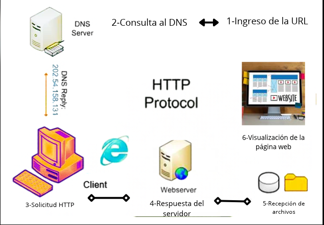

# bitacora-fullstack
Bitacore tecnica del curso desarrollador web fullstack

## Datos del estudiante

- **Nombre:** Josue Emanuel Cruz Fernandez
- **Curso:** Desarrollador web fullstack
- **Módulo:** Fundamentos de la web y pensamiento digital

## Objetivo del repositorio

Documentar las actividades, prácticas y conocimientos adquiridos durante el curso de Desarrollo Web Full Stack Junior, utilizando Git y GitHub para registrar los avances.

## Tabla de contenido

- [Día 1: Fundamentos de la web](#día-1--13-de-noviembre-de-2026)
- [Actividad A1: Modelo cliente-servidor](#actividad-a1-modelo-cliente-servidor)
- [Actividad B1: Dominio, hosting y servidor](#actividad-b1-dominio-hosting-y-servidor)
- [Actividad A2: Análisis con DevTools](#actividad-a2-análisis-de-una-página-web-con-devtools)
- [Actividad E1: IA como asistente técnico](#actividad-e1-ia-como-asistente-técnico)

## Día 1 13 de noviembre de 2026
### Actividad A1: Modelo cliente-servidor
El modelo cliente-servidor sirve para la comunicacion entre un servidor y un navegador. Es decir que la persona pregunta alguna informacion que quiere saber y el servidor responde enviando sugerencias de acuerdo a lo que pregunto y muestra una pagina.

### Pasos del funcionamiento

1. El usuario escribe la dirección URL en el navegador o lo que quiere informacion.
2. El navegador consulta al DNS para obtener la dirección IP.
3. El navegador envía una solicitud HTTP GET al servidor web.
4. El servidor procesa la solicitud y responde con un código de estado, por ejemplo 200 que significa que la pagina cargo correctamente.
5. El navegador recibe el HTML y solicita los archivos CSS, JavaScript e imágenes.
6. El navegador interpreta los archivos y muestra la página web a la persona.

### Esquema cliente-servidor

### Actividad B1: Dominio, hosting y servidor

### Actividad B1: Dominio, hosting y servidor

 Criterio  Dominio  Hosting  Servidor 

### Actividad B1: Dominio, hosting y servidor

| Criterio | Dominio | Hosting | Servidor |

| ¿Qué es? | Es el nombre de un sitio web que se registra y generalmente se paga por año. | Es un servicio que permite alquilar espacio en un servidor para guardar archivos. | Es una computadora física o virtual que puede funcionar las 24 horas, almacenando archivos y respondiendo solicitudes. |
| ¿Para qué sirve? | Permite acceder a una página web sin recordar su dirección IP. | Sirve para almacenar los archivos de un sitio web y permitir el acceso por Internet. | Procesa solicitudes y proporciona información o servicios a los usuarios. |
| ¿Tiene costo? ¿Cuánto aproximadamente? | Generalmente sí, entre $5 y $50 al año. | Puede ser gratuito o costar aproximadamente $4, $6 o $20 mensuales. | Un servidor virtual puede costar desde $4 al mes. |
| Ejemplos reales | google.com, github.com | Vercel, Netlify, Hostinger | DigitalOcean, Hetzner, AWS EC2 |

### Actividad A2: Análisis de una página web con DevTools

**Sitio analizado:** https://www.wikipedia.org

Para esta actividad utilicé las herramientas de desarrollador de Firefox, específicamente la pestaña Red, para observar las solicitudes que realiza una página web.

**Resultados obtenidos:**

- Número de solicitudes: 7.
- Método HTTP del documento HTML: GET.
- Código de estado: 200 OK.
- Tres tipos de archivos: HTML, JavaScript e imágenes.
- Tiempo de carga (Load): 1.05 segundos.

**Conclusión:**

Al analizar Wikipedia pude observar cómo el navegador solicita información al servidor utilizando HTTP. También identifiqué los diferentes archivos que necesita una página web para funcionar y el tiempo que tarda en cargarse.

### Actividad E1: Uso responsable de la inteligencia artificial

**Prompt utilizado:**

Actúa como un instructor de desarrollo web. Soy principiante y es mi primer día de un curso Full Stack. Ayúdame a crear la estructura del README de mi repositorio "bitacora-fullstack". Debe incluir mis datos, el objetivo del repositorio, una tabla de contenido y una sección por cada día de clase. Responde en formato Markdown y explica en una línea para qué sirve cada sección.

**¿Qué partes me sirven?**

Me sirve la estructura que propuso la IA para organizar mi README, porque incluye mis datos, el objetivo del repositorio, una tabla de contenido y las secciones para documentar cada día de clase.

**¿Qué cambiaría?**

Agregaría las actividades que realizamos en clase, como el modelo cliente-servidor, la tabla comparativa de dominio, hosting y servidor, y el análisis de una página web con DevTools.

**¿Encontré algún dato incorrecto?**

Para mi esta bien ya otra cosa es agregar unos puntos claves de lo que vimos en clase pero esta bien el pront para mi punto de vista.
